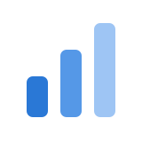

### Alexandre Oliveira

I build open-source tools for working with coding agents without losing track of them, and the Windows apps the platform should have shipped. I also work on [Viglet](https://www.viglet.org): open-source search and content tools for organisations with a lot to publish.

<br clear="left">

##  Start here: Claude Code Tray

**[Claude Code Tray](https://alegauss.github.io/claude-tray/)** puts your Claude Code rate limit in the Windows tray. The icon turns red before you run out, and a weekly forecast is paced to the hours you actually work. It reads the session files already on your disk: no account, no service.

```
winget install alegauss.ClaudeCodeTray
```

## For Claude Code

-  **[roadkeep](https://alegauss.github.io/roadkeep/)**: owns the writes to your ROADMAP, CHANGELOG and IMPROVEMENTS, so the format is enforced instead of remembered. CLI and Claude Code plugin.
-  **[commitclerk](https://alegauss.github.io/commitclerk/)**: reads your staged diff, drafts a Conventional Commits message, shows it to you, and commits.
-  **[winwright](https://alegauss.github.io/winwright/)**: drives a Windows desktop app from a test, with four verdicts instead of two, so a check that never ran never reads as one that passed.
-  **[polyweave](https://alegauss.github.io/polyweave/)**: makes 3D assets by declaring what they must satisfy, on Blender and Godot.

## For Windows

-  **[FreeWilly](https://alegauss.github.io/freewilly/)**: Docker on Windows without Docker Desktop.
-  **[Quickshell](https://alegauss.github.io/quickshell/)**: SSH on Windows without the suite around it.
-  **[PPortal](https://alegauss.github.io/pportal/)**: PlayStation Remote Play as a real Windows app.

## Measured, not recalled

-  **[Usage Simulator](https://alegauss.github.io/claude-code-usage/)**: what a Claude Code task really costs, and how far each plan carries you, from real session transcripts.
-  **[Time Study](https://alegauss.github.io/claude-code-time-study/)**: where the hours went on an AI-assisted project, from session records and git history.

##  Viglet

-  **[Turing](https://turing.viglet.org)**: search for sites with a lot of content, with AI answers drawn only from your own pages. Self-hosted, no per-user licence.
-  **[Shio](https://shio.viglet.org)**: a content system where a new page goes live the same day, reviewed by your own team.
-  **[Dumont](https://docs.viglet.org/dumont/)**: gathers content from portals, back-office systems and PDFs and feeds it to the search.

---

Everything, with what each product shipped and what comes next: **[alegauss.github.io](https://alegauss.github.io/)**
